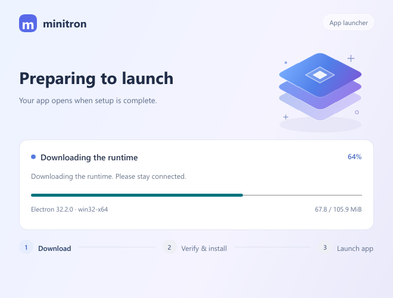

# minitron

**Smaller Electron packages, shared runtime.**

**English** | [简体中文](README.zh-CN.md)

minitron packages Electron apps separately from their runtime. Apps ship with a small launcher and share the same Electron installation, reducing repeated runtime downloads and app update sizes.

- App-only packages with ASAR and native module support.
- Shared runtimes with resumable downloads and automatic cleanup.
- Background updates and rollback to the previous app version.
- English and Chinese, selected automatically from the system display language.

Available for **Windows x64**. First launch downloads Electron; subsequent launches reuse the installed runtime.



## Quick start

Build tools: Node.js 22.12+, Rust 1.92+, MSVC/Windows SDK and NSIS. Native modules also use Python and C++ build tools.

```powershell
git clone https://github.com/aak1247/minitron.git
cd minitron

./scripts/build-windows.ps1 -RuntimeVersion 32.2.0 -ManifestUrl https://example.com/myapp/manifest.json
```

Set the Electron version and update URL to match the application. This builds the included example app. For an existing app, see [Packaging an app](docs/usage.md#packaging-an-app).

Outputs in `dist/windows/1.0.0/`:

| Output | Use |
|---|---|
| `application/` | App directory without Electron |
| `MyApp-Setup-1.0.0.exe` | Windows installer |
| `app-1.0.0-win32-x64-electron-32.2.0.zip` | App update package |

The launcher downloads Electron from the configured update source. See [Publishing updates](docs/usage.md#publishing-updates) to set up that source.

## Launch

Open `shell.exe` in the application directory. Updates download in the background and take effect on the next launch.

```powershell
./shell.exe --offline       # Launch without network access
./shell.exe --no-update     # Launch without checking for app updates
./shell.exe --rollback      # Restore the previous app version
./shell.exe --help          # Show available options
```

## Language

The launcher follows the system display language. Chinese uses Simplified Chinese; other languages use English.

```powershell
$env:MINITRON_LANG = 'en'    # English
$env:MINITRON_LANG = 'zh'    # Chinese
$env:MINITRON_LANG = 'auto'  # Follow the system; also the default when unset
```

See the [usage guide](docs/usage.md) for app packaging, configuration and signed updates.
