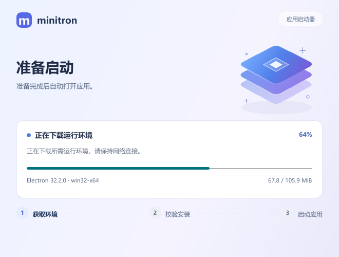

# minitron

**更小的 Electron 应用包，共享同一份运行时。**

[English](README.md) | **简体中文** · [下载](https://github.com/aak1247/minitron/releases/latest) · [npm](https://www.npmjs.com/package/minitron-builder)

minitron 将 Electron 应用与运行时分开打包。应用安装包包含轻量原生启动器，多个应用可复用同一份 Electron 运行时。

- 仅包含应用的 ASAR 包，支持原生模块。
- 共享运行时、断点续传和自动清理。
- 后台更新与上一版本回滚。
- 根据系统显示语言自动选择中文或英文。

支持 **Windows x64、Linux x64、macOS Intel / Apple Silicon**。



## 快速开始

需要 Node.js 22.12 或更新版本。在目标操作系统上的现有 Electron 项目目录中运行。项目已编译时可跳过 `npm run build`。

```sh
npm install -D minitron-builder
npm run build
npx minitron-builder
```

CLI 会读取现有 electron-builder 配置或 `package.json` 中的 `build`，并下载匹配平台和架构的 Minitron 启动器。普通的 Electron 开发流程不变；应用仍使用 electron-builder 中已有的 `appId`、`productName`、图标、文件、`extraResources`、`asarUnpack` 和安装选项。

下面是覆盖三个平台的简短 `package.json` 示例：

```json
{
  "homepage": "https://example.com/my-app",
  "author": { "name": "Example", "email": "packaging@example.com" },
  "build": {
    "appId": "com.example.desktop",
    "productName": "Example Desktop",
    "asar": true,
    "directories": { "output": "release" },
    "win": { "target": ["nsis"], "icon": "build/app.ico" },
    "linux": { "target": ["deb", "rpm"], "icon": "build/app.png" },
    "mac": { "target": ["dmg", "pkg"], "icon": "build/app.png" }
  }
}
```

默认目标是当前平台。需要时可指定格式：

```sh
npx minitron-builder --win nsis
npx minitron-builder --linux deb rpm
npx minitron-builder --mac dmg pkg --x64
npx minitron-builder --mac dmg pkg --arm64
```

macOS x64 与 arm64 需分别构建。Linux DEB/RPM 需要 `homepage` 和有效维护者邮箱。产物写入 `build.directories.output` 指定的目录；未配置时写入 `dist`。

首次启动不需要更新服务器：应用会从 Electron 官方分发源下载共享运行时。应用内更新可稍后添加 manifest，见[更新指南](docs/usage.zh-CN.md#发布更新)。macOS 卸载前请在终端运行应用内的 `minitron-uninstall.command`；拖到废纸篓不会自动运行卸载脚本。

## 包体积

v0.4.1，使用内置示例应用和 Electron 32.2.0。下载列为压缩包体积，其余为解压后的文件大小。

| 平台 | 启动器下载 | 启动器 | 示例应用目录 | Electron 运行时 |
|---|---:|---:|---:|---:|
| Windows x64 | [5.21 MiB](https://github.com/aak1247/minitron/releases/download/v0.4.1/minitron-v0.4.1-windows-x64.zip) | 9.70 MiB | 9.71 MiB | 264.74 MiB |
| Linux x64 | [6.53 MiB](https://github.com/aak1247/minitron/releases/download/v0.4.1/minitron-v0.4.1-linux-x64.tar.gz) | 13.28 MiB | 13.29 MiB | 264.98 MiB |
| macOS Intel | [5.31 MiB](https://github.com/aak1247/minitron/releases/download/v0.4.1/minitron-v0.4.1-macos-x64.tar.gz) | 9.75 MiB | 9.76 MiB | 246.06 MiB |
| macOS Apple Silicon | [5.14 MiB](https://github.com/aak1247/minitron/releases/download/v0.4.1/minitron-v0.4.1-macos-arm64.tar.gz) | 8.49 MiB | 8.49 MiB | 239.90 MiB |

示例应用目录包含启动器、配置和应用资源，不含共享运行时。示例的应用更新 ZIP 仅 **8.22 KiB**。完整字节数见 Release 中的 [sizes.json](https://github.com/aak1247/minitron/releases/download/v0.4.1/sizes.json)。

Karvis AI 2.0.0 的 Windows 安装包（Electron 28.3.3、NSIS）：**77.34 MiB → 10.56 MiB**，缩小约 **86%**。共享运行时另计，在首次启动时下载一次。

Karvis AI 2.0.0 的 Linux 与 macOS 安装包（Electron 28.3.3，共享运行时单独下载）：

| 平台 | 格式 | 安装包体积 |
|---|---|---:|
| Linux x64 | DEB / RPM | 7.65 / 7.67 MiB |
| macOS Intel | PKG / DMG | 12.79 / 14.24 MiB |
| macOS Apple Silicon | PKG / DMG | 12.55 / 13.98 MiB |

## 高级用法

便携应用目录和单独安装启动器见[打包指南](docs/usage.zh-CN.md#打包应用)，也可从[预编译版本](https://github.com/aak1247/minitron/releases/latest)手动安装启动器。

Linux 需要桌面环境、glibc 2.35+、fontconfig、X11 或 Wayland 及 xkbcommon。Ubuntu 22.04+ 可运行 `sudo apt-get install libfontconfig1 libxkbcommon0 libxkbcommon-x11-0 libx11-xcb1 libxcursor1 libxi6` 安装启动器依赖；Electron 还需要 GTK3、通知、NSS、音频和 GBM 等桌面库。

参见[通用 electron-builder 示例](examples/electron-builder/README.zh-CN.md)、[Karvis 接入示例](examples/karvis/README.zh-CN.md)和[使用指南](docs/usage.zh-CN.md)。

启动器跟随系统显示语言：中文系统使用简体中文，其他语言使用英语。可通过 `MINITRON_LANG=en`、`zh` 或 `auto` 手动指定。
